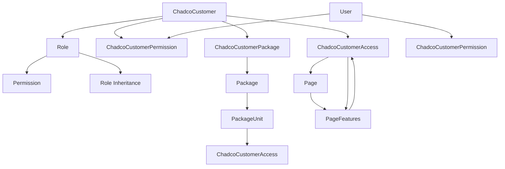

# Access Control System Documentation
## سیستم کنترل دسترسی و سطوح دسترسی

### Overview | نمای کلی سیستم

This system is designed to manage user access levels to different parts of a software application. The system consists of four main components:

این سیستم برای مدیریت سطح دسترسی کاربران به بخش‌های مختلف یک نرم‌افزار طراحی شده است. در این طراحی، چهار عنصر اصلی وجود دارد:

1. **Users (کاربران)** - System users who need access to features
2. **Roles (نقش‌ها)** - Collections of permissions assigned to users
3. **Permissions (مجوزها)** - Specific access rights to pages and features
4. **Customers (مشتریان)** - Organizations/companies using the system

The goal of this structure is to provide precise control over access to pages and features for each customer. A JSON file format is used to register and review these access rights.

هدف این ساختار، کنترل دقیق دسترسی به صفحات و امکانات (Features) برای هر مشتری است. برای ثبت و بررسی این دسترسی‌ها، از یک فایل با فرمت JSON استفاده می‌شود.

---

## Core Components | اجزای اصلی

### 1. Permissions (مجوزها)

Each permission specifies what access rights exist for specific pages or features. This information is stored in a JSON file that determines which pages and capabilities that permission allows access to.

هر مجوز مشخص می‌کند که چه دسترسی‌هایی به صفحات یا ویژگی‌های خاص وجود دارد. این اطلاعات در قالب یک فایل JSON ذخیره می‌شود که مشخص می‌کند آن مجوز اجازه دسترسی به چه صفحات و قابلیت‌هایی را می‌دهد.

**Database Table: `Permission`**
```sql
CREATE TABLE Permission (
    id INTEGER PRIMARY KEY,
    name VARCHAR(255) NOT NULL,
    description TEXT,
    resource VARCHAR(255) NOT NULL,  -- Page or feature identifier
    action VARCHAR(255) NOT NULL     -- read, write, delete, admin
);
```

**JSON Structure Example:**
```json
{
  "permissions": {
    "dashboard": {
      "read": true,
      "write": false,
      "delete": false,
      "admin": false
    },
    "customers": {
      "read": true,
      "write": true,
      "delete": false,
      "admin": false
    },
    "reports": {
      "read": true,
      "write": false,
      "delete": false,
      "admin": false
    }
  }
}
```

### 2. Roles (نقش‌ها)

Roles are collections of permissions that can be assigned to users. Each role, in addition to its permissions, has its own JSON file that specifies which access rights are included or excluded.

نقش‌ها مجموعه‌ای از مجوزها هستند که می‌توانند به کاربران اختصاص داده شوند. هر نقش، علاوه بر مجوزهایش، یک فایل JSON مخصوص به خودش دارد که در آن مشخص شده کدام دسترسی‌ها (include) یا (exclude) هستند.

**Database Table: `Role`**
```sql
CREATE TABLE Role (
    id INTEGER PRIMARY KEY,
    chadco_customer_id INTEGER NOT NULL,
    name VARCHAR(255) NOT NULL,
    description TEXT,
    inherited_roles JSON,        -- Roles this role inherits from
    accesses_json JSON,          -- Role-specific access overrides
    FOREIGN KEY (chadco_customer_id) REFERENCES ChadcoCustomer(id)
);
```

**Role Permission Resolution Process:**

1. **Step 1**: Combine all permissions related to the role into a single JSON file
   - Priority is given to `true` values
   - All permissions for a role are merged into one JSON file

2. **Step 2**: Compare this JSON file with the role's own JSON file
   - For any differences, priority is given to the role's own JSON file
   - This creates the final JSON file

3. **Step 3**: Send the final JSON to the frontend for access level checking

**JSON Structure Example:**
```json
{
  "role_permissions": {
    "dashboard": {
      "read": true,
      "write": false,
      "delete": false,
      "admin": false
    },
    "customers": {
      "read": true,
      "write": true,
      "delete": true,
      "admin": false
    }
  },
  "role_overrides": {
    "customers": {
      "delete": false  // Override: remove delete permission
    },
    "reports": {
      "read": true     // Override: add read permission
    }
  }
}
```

### 3. Customer Permissions (مجوز آژانس)

This section specifies which pages and features each agency (organization or company using the system) has access to.

این بخش مشخص می‌کند که هر آژانس(سازمان یا شرکت استفاده‌کننده از سیستم) به چه صفحاتی و امکاناتی دسترسی دارد.

**Process:**
1. Each customer selects one of the available packages
2. Based on this selection, a JSON file is created that shows what permissions the agency has
3. If the agency changes its package, the information about which roles and permissions the agency has access to is updated

**Database Tables:**
- `ChadcoCustomer` - Customer information
- `ChadcoCustomerPackage` - Customer-package associations
- `ChadcoCustomerPackageUnit` - Customer-package unit associations
- `ChadcoCustomerAccess` - Customer access rights to features

**JSON Structure Example:**
```json
{
  "customer_access": {
    "package_id": 1,
    "package_units": [1, 2, 3],
    "permissions": {
      "dashboard": {
        "read": true,
        "write": false
      },
      "customers": {
        "read": true,
        "write": true,
        "delete": false
      }
    },
    "restrictions": {
      "max_customers": 100,
      "max_users": 5,
      "features": ["basic_reporting", "email_support"]
    }
  }
}
```

### 4. Pages (صفحات)

This table maintains a list of all system pages. Each page has a unique code that is used to identify it in the system.

این جدول، فهرستی از تمام صفحات سیستم را نگهداری می‌کند. هر صفحه یک کد یکتا (code) دارد که برای شناسایی آن در سیستم استفاده می‌شود.

**Database Table: `Page`**
```sql
CREATE TABLE Page (
    id INTEGER PRIMARY KEY,
    name VARCHAR(255) NOT NULL,
    path VARCHAR(500) NOT NULL,
    code VARCHAR(100) UNIQUE NOT NULL,  -- Unique identifier
    description TEXT
);
```

### 5. Page Features (ویژگی‌های صفحات)

Each page may have several specific features or capabilities, such as:
- Viewing information
- Editing or deleting data
- Generating outputs or reports

These features are stored in a separate table and are related to pages.

هر صفحه ممکن است چند ویژگی یا قابلیت خاص داشته باشد، مثل:
- مشاهده اطلاعات
- ویرایش یا حذف داده‌ها
- گرفتن خروجی یا گزارش

این ویژگی‌ها در یک جدول جداگانه ذخیره می‌شوند و با صفحات مرتبط هستند.

**Database Table: `PageFeatures`**
```sql
CREATE TABLE PageFeatures (
    id INTEGER PRIMARY KEY,
    page_id INTEGER NOT NULL,
    name VARCHAR(255) NOT NULL,
    description TEXT,
    feature_type ENUM('read', 'write', 'delete', 'admin') NOT NULL,
    FOREIGN KEY (page_id) REFERENCES Page(id)
);
```

---

## Access Control Flow | جریان کنترل دسترسی

### 1. User Authentication
```
User Login → Verify Credentials → Load User Profile
```

### 2. Permission Resolution
```
User → Role → Permissions → Package Units → Final Access JSON
```

### 3. Access Checking
```
Request Page/Feature → Check Final Access JSON → Allow/Deny Access
```

---

## JSON Schema Definitions | تعریف ساختار JSON

### Permission JSON Schema
```json
{
  "type": "object",
  "properties": {
    "permissions": {
      "type": "object",
      "patternProperties": {
        "^[a-zA-Z_][a-zA-Z0-9_]*$": {
          "type": "object",
          "properties": {
            "read": { "type": "boolean" },
            "write": { "type": "boolean" },
            "delete": { "type": "boolean" },
            "admin": { "type": "boolean" }
          }
        }
      }
    }
  }
}
```

### Role JSON Schema
```json
{
  "type": "object",
  "properties": {
    "role_permissions": {
      "type": "object",
      "patternProperties": {
        "^[a-zA-Z_][a-zA-Z0-9_]*$": {
          "type": "object",
          "properties": {
            "read": { "type": "boolean" },
            "write": { "type": "boolean" },
            "delete": { "type": "boolean" },
            "admin": { "type": "boolean" }
          }
        }
      }
    },
    "role_overrides": {
      "type": "object",
      "patternProperties": {
        "^[a-zA-Z_][a-zA-Z0-9_]*$": {
          "type": "object",
          "properties": {
            "read": { "type": "boolean" },
            "write": { "type": "boolean" },
            "delete": { "type": "boolean" },
            "admin": { "type": "boolean" }
          }
        }
      }
    }
  }
}
```

---

## Implementation Examples | نمونه‌های پیاده‌سازی

### Frontend Access Check
```javascript
// Check if user has access to a specific feature
function hasAccess(userPermissions, page, feature) {
  return userPermissions[page] && userPermissions[page][feature] === true;
}

// Example usage
const userPermissions = {
  "dashboard": { "read": true, "write": false },
  "customers": { "read": true, "write": true, "delete": false }
};

if (hasAccess(userPermissions, "customers", "write")) {
  // Show edit button
  showEditButton();
}
```

### Backend Permission Resolution
```python
def resolve_user_permissions(user_id, customer_id):
    # Get user's roles
    roles = get_user_roles(user_id, customer_id)
    
    # Get permissions for each role
    all_permissions = {}
    for role in roles:
        role_permissions = get_role_permissions(role['id'])
        all_permissions = merge_permissions(all_permissions, role_permissions)
    
    # Apply role-specific overrides
    for role in roles:
        if role['accesses_json']:
            overrides = json.loads(role['accesses_json'])
            all_permissions = apply_overrides(all_permissions, overrides)
    
    return all_permissions
```

---

## Security Considerations | ملاحظات امنیتی

1. **JSON Validation**: Always validate JSON structure before processing
2. **Permission Inheritance**: Ensure proper inheritance rules are followed
3. **Access Logging**: Log all access attempts for audit purposes
4. **Token Expiration**: Implement proper session management
5. **Role Hierarchy**: Maintain proper role hierarchy and inheritance

---

## Database Relationships | روابط پایگاه داده



---

## API Endpoints | نقاط پایانی API

### Get User Permissions
```
GET /api/permissions/user/{user_id}/customer/{customer_id}
```

### Update Role Permissions
```
PUT /api/roles/{role_id}/permissions
```

### Check Access
```
POST /api/access/check
{
  "user_id": 123,
  "customer_id": 456,
  "page": "customers",
  "feature": "write"
}
```

---

## Troubleshooting | عیب‌یابی

### Common Issues
1. **Permission Not Working**: Check JSON structure and inheritance
2. **Role Override Not Applied**: Verify role JSON format
3. **Access Denied**: Check package unit associations
4. **JSON Parse Error**: Validate JSON syntax

### Debug Steps
1. Check user's roles
2. Verify role permissions
3. Check package unit access
4. Validate final JSON structure
5. Test with different user scenarios
